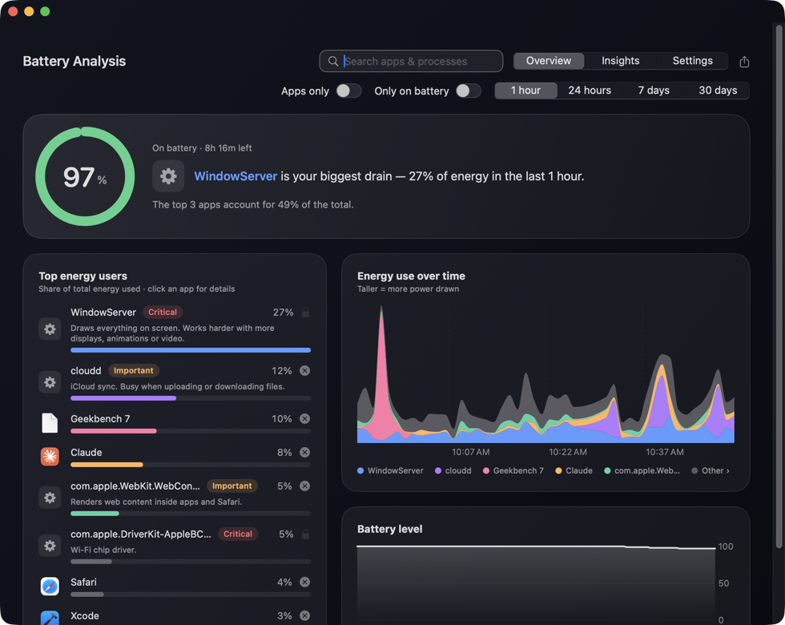
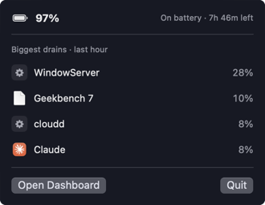

# Battery Analysis

A macOS menu bar app that tracks which apps and background processes use the most energy.

<p>
  
  
</p>

Activity Monitor shows energy use for the last 12 hours, but it lists system processes like `cloudd` or `mds_stores` with no explanation. Battery Analysis keeps 30 days of history and says what each of those processes does.

## What it does

- Ranks apps and processes by their share of energy use over the last hour, day, week or month. Helper processes such as "Chrome Helper" count toward their parent app.
- Gives each system process a one-line description and marks it Critical, Important or Optional, so you know whether it's safe to quit.
- Charts energy use over time and battery level. Click an app to see its own history and trend.
- Shows battery health (capacity, cycle count), a weekly summary, and how usage differs on battery vs. plugged in.
- Shows your Mac's current power draw next to the ⚡ in the menu bar, and while it's plugged in, the power coming in from the charger and how much of it is going into the battery.
- Lists devices plugged into the USB-C ports (iPhone, iPad, drives and so on) with the power each is drawing from your Mac, next to the Mac's total. In the menu bar they appear by port number after the total and any power coming in, e.g. `11 W  ↓22 W  ④ 15 W`.
- Suggests Low Power Mode when the battery is low and power draw is high, and turns the ⚡ yellow. Customizable thresholds.
- Notifies you when one app is using most of your energy, or when the battery is low. Both are on by default and can be turned off in Settings.
- Lets you quit or force quit a process from the list, after confirming. The dialog says how many processes that covers. Processes macOS needs are locked.
- Search, filter to apps only or time on battery, and export to CSV.
- A Stats tab, just for fun: running totals of the energy your Mac has used (split by app), taken in from chargers and given to connected devices, with everyday equivalents, an electricity cost estimate and records.

It runs from the menu bar and only appears in the Dock while the dashboard is open.

## Requirements

macOS 14 or later
Xcode or the Swift 5.9+ toolchain to build.

Tested on Apple Silicon. An x86_64 build also works under Rosetta 2 on Apple Silicon, but I haven't tried it on a real Intel Mac, where the battery and power readings may differ.

## Build

```bash
git clone https://github.com/jadinnnnr/battery-analysis.git
cd battery-analysis
./build.sh --install
```

`./build.sh` on its own builds `BatteryAnalysis.app` in the project folder; `--install` also copies it to `/Applications`.

Run the tests with:

```bash
swift test
```

The app is ad-hoc signed and not notarized. A copy you build yourself opens normally. If you move a built copy to another Mac and macOS blocks it, go to System Settings › Privacy & Security and click Open Anyway.

## How it works

The app keeps one `top` process running in logging mode and reads each process's Energy Impact every 30 seconds. That's the same score Activity Monitor uses. It's a relative measure, not watts, so the percentages in the app are each process's share of the total.

The menu bar wattage comes from the Mac's system power sensor (SMC key `PSTR`), read every 5 seconds by default (2 and 10 are options). Macs without that sensor fall back to the battery's own reading, which macOS only refreshes about once a minute.

Connected devices come from the USB-C port controllers, which report what's attached, and the SMC's per-port current and voltage sensors (`D1JI`/`D1JV` and so on). Which sensor belongs to which port isn't documented: the app assumes they follow port order, and corrects that the first time it sees a single device plugged in. A port charging the Mac isn't listed as a device.

Power coming in comes from the SMC's DC-in sensors (`PDTR` for watts, `VD0R` for volts), which agree with the battery's own `SystemPowerIn` but update every few seconds. The charger's port and rating come from its USB-C power negotiation, and the battery's charge rate from its voltage and current. Macs without those sensors use the battery's figure, which updates about once a minute.

The Stats tab adds those readings up every 10 seconds while the Mac is awake: the Mac's total, power coming in, power into the battery and power out to each device, in watt-hours. Energy per app is an estimate: the Mac's own share (its total minus what devices drew) is split by each app's share of Energy Impact in the next sample, so it includes shared costs like the display. Time asleep isn't counted, and totals start when you install this version; older history only has Energy Impact scores, not watts.

In testing on an Apple Silicon MacBook, the app used about 0.3% of one CPU core and its `top` process about another 0.3%. Updating the wattage every 2 seconds instead of 5 adds roughly 0.2%.

## Privacy

There's no network code, and the app never asks for administrator rights. It writes to:

- `~/Library/Application Support/BatteryAnalysis/`: usage history, deleted after 30 days, and `stats.json`, the Stats tab's totals, kept until you reset them
- `~/Library/Preferences/local.batteryanalysis.plist`: settings
- `~/Library/LaunchAgents/local.batteryanalysis.login.plist`: only if you turn on launch at login

It only stops a process when you confirm Quit or Force Quit, or tap "Quit it" on a notification. Notifications offer "Quit it" only for apps, which get a normal Quit request. It never changes Low Power Mode itself.

## Uninstall

Turn off launch at login in the Settings tab, quit from the ⚡ menu, and delete `/Applications/BatteryAnalysis.app`. To remove its data too:

```bash
rm -rf ~/Library/Application\ Support/BatteryAnalysis
```

```bash
defaults delete local.batteryanalysis
```

## Limitations

- Energy Impact is macOS's estimate, not a measurement of battery drain per app.
- Each sample covers the 80 heaviest processes, and the history keeps the top 12 apps per sample.
- 87 common system processes have written descriptions. The rest get a generic one.
- Connected devices need per-port power sensors, which I've only confirmed on an M5 MacBook Pro. Macs without them don't show the list. Devices behind a hub share one reading.

## Code

| File | Contents |
|---|---|
| `App.swift` | Entry point, menu bar icon, Dock behavior |
| `Sampler.swift` | `top` stream, PID-to-app mapping, battery state |
| `LivePower.swift` | SMC sensor reads, menu bar wattage |
| `Health.swift` | Battery health, Low Power Mode state |
| `Ports.swift` | Connected devices, per-port power, charger input |
| `Stats.swift` | Running energy totals for the Stats tab |
| `StatsView.swift` | The Stats tab |
| `Tracker.swift` | History storage and the main analysis |
| `Analytics.swift` | Per-app history, weekly summary, CSV export |
| `Views.swift` | Dashboard and menu bar popover |
| `Insights.swift` | Insights and Settings tabs |
| `Detail.swift` | Per-app detail view |
| `ProcessInfo.swift` | Process descriptions |
| `Killer.swift` | Quitting processes |
| `Alerts.swift` | Notifications |
| `Settings.swift` | Preferences, launch at login |
| `Models.swift` | Shared data types |

All in `Sources/BatteryAnalysis/`. Tests are in `Tests/BatteryAnalysisTests/`. `build.sh` packages and signs the app bundle.

## License

[MIT](LICENSE)
